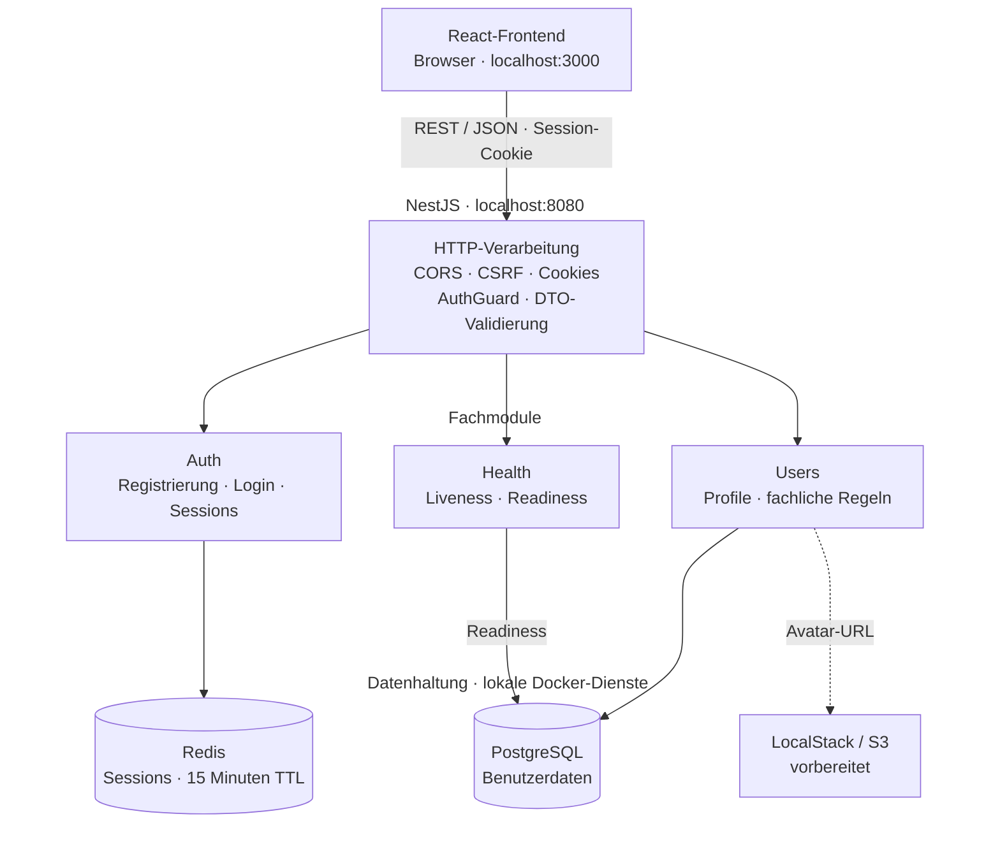
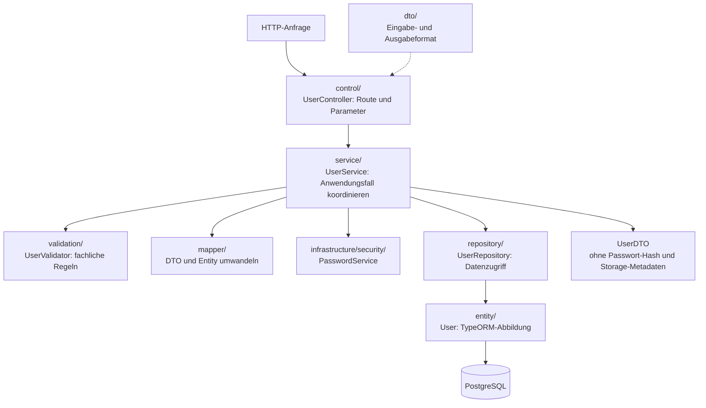
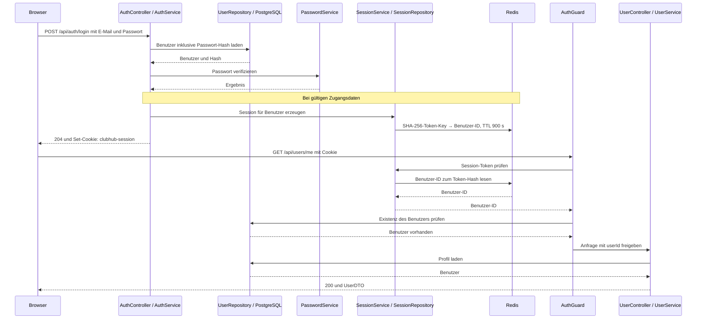

# ClubHub Backend · TypeScript

ClubHub ist eine Plattform für studentische Clubs und den Austausch innerhalb einer Hochschul-Community. Dieses Repository enthält die schrittweise Neuimplementierung meines [Java-Backends](https://github.com/Danosch/clubhub-backend) mit TypeScript und NestJS. Im Mittelpunkt stehen eine nachvollziehbare Architektur, klar abgegrenzte Verantwortlichkeiten und eine API, die sich unabhängig von der Oberfläche weiterentwickeln lässt.

**Stand: 21. Oktober 2026.** Aktuell umgesetzt sind Benutzerverwaltung, Authentifizierung mit Redis-Sessions und Health-Checks. Die TypeScript-Version bildet bislang einen Teil des Funktionsumfangs der Java-Version ab.

## Inhaltsverzeichnis

- [Tech-Stack](#tech-stack)
- [Herkunft des Frontends](#herkunft-des-frontends)
- [Aktueller Funktionsumfang](#aktueller-funktionsumfang)
- [Architektur](#architektur)
- [Verzeichnisstruktur](#verzeichnisstruktur)
- [API-Endpunkte](#api-endpunkte)
- [Vergleich mit dem Java-Backend](#vergleich-mit-dem-java-backend)
- [Lokal starten](#lokal-starten)
- [Tests und Entwicklung](#tests-und-entwicklung)

## Tech-Stack

Für dieses Projekt habe ich mit **TypeScript, Node.js, NestJS, PostgreSQL und Redis** zentrale Backend-Technologien aus dem Tech-Stack von **snapAddy** genutzt. Ergänzt wird das Backend durch TypeORM und Docker Compose; das beigefügte Frontend verwendet React, Vite und Tailwind CSS.

## Herkunft des Frontends

**Das in [`frontend/`](frontend/) enthaltene Frontend stammt nicht von mir.** Es wurde von [viator32](https://github.com/viator32), einem ehemaligen Arbeitskollegen und Kommilitonen von mir, entwickelt. Ich habe seine Erlaubnis, es in diesem Projekt zu verwenden und bereitzustellen.

Mein Schwerpunkt in diesem Repository liegt auf dem TypeScript-Backend und dessen Anbindung an die vorhandene Oberfläche. Das Frontend dient dazu, die Backend-Funktionen im Anwendungskontext zu demonstrieren. Die mitgelieferte [Lizenzdatei des Frontends](frontend/LICENSE) enthält die Apache License 2.0.

## Aktueller Funktionsumfang

| Bereich | Aktueller Stand |
| --- | --- |
| Registrierung | Benutzer anlegen; E-Mail-Domain konfigurierbar; doppelte E-Mail-Adressen abfangen |
| Anmeldung | Passwort prüfen, zufällige Session erzeugen, HttpOnly-Cookie setzen |
| Sessions | Redis-Speicherung mit 15 Minuten TTL; Refresh und Logout |
| Zugriffsschutz | Globaler Auth-Guard; öffentliche Routen explizit mit `@Public()` markiert |
| Benutzerprofile | Alle Benutzer, eigenes Profil und einzelne Benutzer lesen; eigenes Profil teilweise ändern |
| Passwortspeicherung | Salted scrypt, anschließend HMAC-SHA256 mit konfiguriertem Pepper |
| Eingabeprüfung | Globale `ValidationPipe`, DTO-Validierung und fachliche Validatoren |
| Datenbank | TypeORM, PostgreSQL und versionierte Migrationen; `synchronize: false` |
| Health-Checks | Liveness sowie Readiness mit PostgreSQL-Prüfung |
| Tests | Vier Integrationstest-Dateien für Benutzer-Repositories und -Services mit echter PostgreSQL-Datenbank |
| Dateispeicher | LocalStack in Compose vorbereitet; Avatar-URLs werden aus vorhandenen Metadaten gebildet |

**Noch nicht im TypeScript-Backend implementiert:** Clubs und Mitgliedschaften, Beiträge, Kommentare, Foren, Veranstaltungen, Feed, Avatar-Uploads, Passwortänderung und Kontolöschung. Auch für die im Frontend sichtbaren Bereiche Bookmarks, Benachrichtigungen, Administration und Support gibt es hier noch keine entsprechenden Backend-Module. Die Oberfläche kann deshalb mehr Funktionen anzeigen, als dieses Backend bereits bereitstellt.

Die Readiness-Prüfung berücksichtigt aktuell nur PostgreSQL. Redis und LocalStack sind nicht Bestandteil dieses Checks. Authentifizierung, Controller und der vollständige HTTP-Ablauf besitzen noch keine eigenen Integrationstests; die vorhandenen Tests rufen Repositories und Services direkt auf.

## Architektur

### Systemübersicht

Das Backend ist ein **modularer Monolith** mit einem Backend-Prozess und klar abgegrenzten Fachmodulen. PostgreSQL hält dauerhafte Benutzerdaten; Redis hält zeitlich begrenzte Sessions. Die Übersicht zeigt die wichtigsten Verbindungen von der Oberfläche bis zur Datenhaltung.



Die Fachmodule teilen sich technische Dienste, etwa das Passwort-Hashing im `SecurityModule`. Das Auth-Modul nutzt außerdem die Benutzerverwaltung. Bei geschützten Anfragen prüft der globale Auth-Guard die Session in Redis und die Existenz des Benutzers in PostgreSQL; öffentliche Routen sind davon ausgenommen.

Die gestrichelte Verbindung beschreibt ausschließlich die Bildung einer Avatar-URL aus gespeicherten Metadaten. Der aktuelle Backend-Code enthält keinen S3-Client und keinen Upload-Endpunkt.

### Verantwortlichkeiten innerhalb eines Moduls

Am Beispiel der Benutzerverwaltung trennt die Struktur HTTP-Verarbeitung, Anwendungslogik und Datenzugriff. Die Zuordnung der Klassen erfolgt über NestJS-Module und Dependency Injection.



DTO-Validierung prüft die Form einer Anfrage, etwa E-Mail-Format und Feldlängen. Fachliche Validatoren prüfen Regeln wie erlaubte Registrierungsdomain, verfügbare E-Mail-Adresse und Eigentümerschaft des zu ändernden Profils. Mapper übernehmen die Datenumwandlung; Repositories kapseln die Datenbankoperationen.

### Ablauf einer Anmeldung und einer geschützten Anfrage



Das Token entsteht aus 32 zufälligen Bytes und wird als 64-stellige Hex-Zeichenfolge übertragen. Redis speichert den SHA-256-Hash des Tokens im Schlüssel `auth:session:<hash>` und die Benutzer-ID als Wert. Das Cookie heißt `clubhub-session`, hat den Pfad `/api`, ist `HttpOnly` und verwendet `SameSite=Lax`. Bei `NODE_ENV=production` wird zusätzlich `Secure` gesetzt.

`refresh` verlängert die Redis-TTL und setzt das Cookie erneut; das Token bleibt dabei gleich. `logout` entfernt die Session und löscht das Cookie. Normale Lesezugriffe verlängern die Session nicht automatisch.

## Verzeichnisstruktur

### Backend und Projektwurzel

```text
.
├── src/
│   ├── main.ts                 # Bootstrap, HTTP-Konfiguration, Port 8080
│   ├── app.module.ts           # Zusammensetzen der Anwendungsmodule
│   ├── common/                 # Modulübergreifende Bausteine
│   │   ├── decorator/          # @Public und @CurrentUserId
│   │   ├── dto/                # Gemeinsame Antwortverträge
│   │   ├── exception/          # Fehlerklassen, Payload und Fehlercodes
│   │   └── type/               # Gemeinsame Typen, z. B. authentifizierte Requests
│   ├── infrastructure/         # Technische Dienste und Verbindungen
│   │   ├── database/           # TypeORM-Modul und CLI-DataSource
│   │   │   └── migrations/     # Versionierte Änderungen am Datenbankschema
│   │   ├── redis/              # Redis-Verbindung und deren Lebenszyklus
│   │   └── security/           # Passwort-Hashing und -Verifikation
│   ├── modules/                # Fachliche Module
│   │   ├── auth/               # Authentifizierung und Session-Verwaltung
│   │   │   ├── control/        # HTTP-Endpunkte für Authentifizierung
│   │   │   ├── dto/            # Auth-Anfrage- und Antworttypen
│   │   │   ├── guard/          # Globaler Zugriffsschutz
│   │   │   ├── repository/     # Session-Speicherung in Redis
│   │   │   ├── service/        # Login, Sessions und Cookie-Verwaltung
│   │   │   └── validation/     # Prüfung der Authentifizierungsergebnisse
│   │   ├── users/              # Benutzerverwaltung
│   │   │   ├── control/        # HTTP-Endpunkte für Profile
│   │   │   ├── dto/            # CreateUserDTO, UpdateUserDTO und UserDTO
│   │   │   ├── entity/         # Persistenzmodell der Benutzer
│   │   │   ├── enum/           # Zulässige Studienfächer
│   │   │   ├── mapper/         # Umwandlung zwischen DTOs und Entities
│   │   │   ├── repository/     # Benutzerabfragen und Schreiboperationen
│   │   │   ├── service/        # Benutzerbezogene Anwendungsfälle
│   │   │   └── validation/     # Domain-, Existenz- und Eigentümerprüfungen
│   │   └── health/             # Modul und Controller für Health-Checks
│   └── test/                   # Integrationstests und Testhilfen
│       ├── helpers/            # Testdatenbank, Datenfabrik und Cleanup
│       ├── repository/user/    # Tests der Benutzerpersistenz
│       └── service/user/       # Tests der Benutzer-Anwendungsfälle
├── frontend/                   # Bereitgestellte Oberfläche von viator32
├── dist/                       # Generierte JavaScript-Dateien des Backend-Builds
├── dist-test/                  # Generierte Dateien für den Testlauf
├── node_modules/               # Installierte Backend-Abhängigkeiten
├── docker-compose.yml          # Lokale PostgreSQL-, Redis- und S3-Umgebung
├── docker-compose.test.yml     # Separate PostgreSQL- und Redis-Testumgebung
├── package.json                # Backend-Abhängigkeiten und npm-Skripte
├── package-lock.json           # Aufgelöste Abhängigkeiten für npm ci
├── tsconfig.json               # Strikte TypeScript- und Build-Konfiguration
└── tsconfig.test.json          # Ausgabe-Konfiguration für die Tests
```

`*.module.ts` verbindet die jeweiligen Controller, Provider und benötigten Module. `dist/`, `dist-test/` und `node_modules/` sind generierte Verzeichnisse und werden nicht als Quellcode gepflegt. Lokale `.env`-Dateien werden durch `.gitignore` ausgeschlossen.

### Frontend

| Verzeichnis | Aufgabe |
| --- | --- |
| `frontend/public/` | Statische Dateien wie Icons und Manifest |
| `frontend/src/` | Anwendungseinstieg, `App.tsx` und globale Styles |
| `frontend/src/components/` | Gemeinsam verwendete UI-Komponenten |
| `frontend/src/constants/` | Gemeinsame Konstanten |
| `frontend/src/layouts/` | Übergreifender Seitenaufbau |
| `frontend/src/routes/` | Routing der Anwendung |
| `frontend/src/services/` | Basis für die fachlichen Frontend-Services |
| `frontend/src/services/api/` | HTTP-Client, Cookie-Übertragung und API-Fehlerbehandlung |
| `frontend/src/utils/` | Hilfsfunktionen, beispielsweise Datumsformatierung |
| `frontend/src/features/auth/` | Login, Registrierung und Zustand der Anmeldung |
| `frontend/src/features/profile/` | Eigene und fremde Benutzerprofile |
| `frontend/src/features/clubs/` | Clubansichten, Mitglieder, Beiträge, Foren und Veranstaltungen |
| `frontend/src/features/feed/` | Zusammengeführte Inhalte im Feed |
| `frontend/src/features/bookmarks/` | Gespeicherte Inhalte |
| `frontend/src/features/notifications/` | Benachrichtigungsansicht |
| `frontend/src/features/admin/` | Benutzerverwaltung, Moderation und Analyseansichten |
| `frontend/src/features/settings/` | Einstellungen |
| `frontend/src/features/support/` | Support-Oberfläche und Service |

Innerhalb der Features enthalten `pages/` die Seiten, `components/` die jeweiligen UI-Bausteine, `hooks/` wiederverwendbare Zustandslogik und `services/` die API-Aufrufe. Nicht jedes Feature benötigt alle vier Unterverzeichnisse. `types.ts` beschreibt Datenmodelle; `mappers.ts` übersetzt API-Daten in die Darstellung des Frontends.

## API-Endpunkte

Die lokale API läuft unter **`http://localhost:8080`**. Fachliche Endpunkte haben den Präfix `/api`; Health-Endpunkte sind davon ausdrücklich ausgenommen. JSON-Anfragen verwenden `Content-Type: application/json`.

„Öffentlich“ bedeutet ohne gültige Session erreichbar. Die globale HTTP-Konfiguration einschließlich CSRF-Prüfung gilt weiterhin. Geschützte Routen erwarten das Session-Cookie; ein Bearer-Token ersetzt dieses Cookie nicht.

| Methode | Pfad | Zugriff | Erfolgsantwort / Verhalten |
| --- | --- | --- | --- |
| `POST` | `/api/auth/register` | Öffentlich | `201`, neues `UserDTO`; startet keine Session |
| `POST` | `/api/auth/login` | Öffentlich | `204`, Session-Cookie; kein JSON-Body |
| `POST` | `/api/auth/logout` | Öffentlich | `204`, Session widerrufen und Cookie löschen; auch ohne Cookie möglich |
| `POST` | `/api/auth/refresh` | Session | `204`, Session-Laufzeit und Cookie erneuern |
| `GET` | `/api/users` | Session | `200`, Array von `UserDTO`; derzeit ohne Pagination |
| `GET` | `/api/users/me` | Session | `200`, Profil des angemeldeten Benutzers |
| `GET` | `/api/users/:id` | Session | `200`, Profil zur UUID |
| `PATCH` | `/api/users/:id` | Session, eigenes Profil | `200`, aktualisiertes `UserDTO` |
| `GET` | `/health/live` | Öffentlich | `200`, `{ "status": "ok" }` |
| `GET` | `/health/ready` | Öffentlich | `200` bei erreichbarer Datenbank; `503` bei fehlgeschlagenem Check |

Die Routen sind in [AuthController](src/modules/auth/control/auth.controller.ts), [UserController](src/modules/users/control/user.controller.ts) und [HealthController](src/modules/health/health.controller.ts) definiert.

### Registrierung und Login

Beispiel für `POST /api/auth/register`, passend zur unten gezeigten Beispielkonfiguration:

```json
{
  "email": "demo@study.thws.de",
  "username": "demo-user",
  "password": "Demo-password-123!"
}
```

`email` muss gültig sein, darf höchstens 255 Zeichen lang sein und muss auf `@<REGISTRATION_EMAIL_DOMAIN>` enden. `username` muss 1–100 Zeichen und mindestens ein Nicht-Leerzeichen enthalten. Das Passwort muss derzeit 6–128 Zeichen lang sein. Unbekannte Felder werden abgewiesen.

Nach der Registrierung erfolgt ein separater Aufruf von `POST /api/auth/login`:

```json
{
  "email": "demo@study.thws.de",
  "password": "Demo-password-123!"
}
```

Browser-Clients senden Cookies mit `credentials: 'include'`. Das beigefügte Frontend verwendet dies bereits in [`ClientApi`](frontend/src/services/api/ClientApi.ts). Die erlaubte Frontend-Origin wird über `FRONTEND_ORIGIN` festgelegt.

### Profil lesen und ändern

Ein `UserDTO` hat beispielsweise folgende Form:

```json
{
  "id": "a6059722-f90a-47a7-aed6-e41f1f956f04",
  "email": "demo@study.thws.de",
  "username": "demo-user",
  "description": null,
  "avatar": null,
  "subject": "NONE"
}
```

Die Profilantwort enthält auch die E-Mail-Adresse. Passwort-Hash und interne Avatar-Speichermetadaten werden nicht ausgegeben.

`PATCH /api/users/:id` akzeptiert ausschließlich `username`, `description` und `subject`:

```json
{
  "username": "neuer-name",
  "description": "Ich interessiere mich für Backend-Entwicklung.",
  "subject": "COMPUTER_SCIENCE"
}
```

Alle Felder sind optional. Fehlende Felder und `null` lassen den bisherigen Wert unverändert. Eine Beschreibung kann mit `""` geleert werden; `"NONE"` setzt das Studienfach zurück. `description` ist auf 1024 Zeichen begrenzt. Zulässige Studienfächer stehen in [`Subject`](src/modules/users/enum/subject.enum.ts). Änderungen an fremden Profilen liefern `403`.

### Fehlerantworten

Fachliche Fehler enthalten `errorCode`, `title`, `details`, `messageParameters` und `sourcePointer`. Die Codes stehen in [`ClubHubErrorCode`](src/common/exception/clubHubErrorCode.ts).

| Status | Typische Ursache |
| --- | --- |
| `400` | Ungültige Eingabe oder UUID, unerlaubte E-Mail-Domain, bereits registrierte E-Mail |
| `401` | Falsche Zugangsdaten, fehlende oder abgelaufene Session |
| `403` | Änderung eines fremden Profils; außerdem mögliche Ablehnung durch CSRF-Prüfung |
| `404` | Benutzer existiert nicht |
| `503` | Readiness-Prüfung der Datenbank schlägt fehl |

Fehler der NestJS-Validierung und der `ParseUUIDPipe` verwenden das Framework-Format. Es gibt derzeit keinen globalen Filter, der sämtliche Fehler in das fachliche Payload-Format übersetzt.

## Vergleich mit dem Java-Backend

Der Vergleich basiert auf dem lokal vorliegenden Quellstand des [Java-Backends, Commit `efc8e5b`](https://github.com/Danosch/clubhub-backend/tree/efc8e5beaedc77d6d5b66ba203e0b1126a9c3068). Referenzen sind insbesondere `pom.xml`, die Pakete `resource/`, `service/`, `repository/`, `security/` und die Flyway-Migration. Es handelt sich um einen Implementierungsvergleich; es wurden keine Performance-Benchmarks durchgeführt.

| Aspekt | Java-Backend | TypeScript-Backend |
| --- | --- | --- |
| Sprache und Laufzeit | Java 21, JVM | TypeScript, Node.js, ECMAScript-Module |
| Framework | Quarkus 3.24.4 | NestJS 12 mit Express-Adapter |
| Build | Maven | npm und TypeScript-Compiler |
| HTTP-Schicht | Jakarta REST, Resource-Interfaces und Implementierungen | NestJS-Controller mit Decorators |
| Dependency Injection | CDI mit `@Inject` | NestJS-Module und Constructor Injection |
| Paketstruktur | Technische Schichten unter `com.clubhub` | Fachliche Module mit jeweils eigenen Schichten |
| Persistenz | Hibernate ORM / JPA, `EntityManager`, PostgreSQL | TypeORM-Repositories, PostgreSQL |
| Migrationen | Flyway mit SQL-Migration | TypeORM-Migration; automatische Ausführung beim Anwendungsstart |
| Authentifizierung | Bearer-Token im `Authorization`-Header | HttpOnly-Session-Cookie |
| Session-Speicherung | `ConcurrentHashMap` im Backend-Prozess | Redis mit Ablaufzeit und gehashten Token-Schlüsseln |
| Token-Erzeugung | Zufällige UUID | 32 kryptografisch zufällige Bytes |
| Session-Refresh | Altes Token entfernen, neues Token erzeugen | TTL verlängern, bestehendes Token beibehalten |
| Registrierung | Liefert Token und meldet direkt an | Liefert Benutzerprofil; Login ist ein eigener Schritt |
| Passwort-Hashing | SHA-256 über Passwort und Pepper | scrypt mit individuellem Salt, danach HMAC-SHA256 mit Pepper |
| Registrierungsdomain | `study.thws.de` im Resource-Code festgelegt | Über `REGISTRATION_EMAIL_DOMAIN` konfigurierbar |
| Profiländerung | `PUT /api/users/{id}` | `PATCH /api/users/:id` mit Eigentümerprüfung |
| Dateispeicher | MinIO-Client und ObjectStorageService, Upload-Funktionen | LocalStack vorbereitet; bisher nur URL-Mapping |
| Fachlicher Umfang | Zusätzlich Clubs, Mitglieder, Beiträge, Kommentare, Foren, Veranstaltungen und Feed | Bisher Authentifizierung, Benutzerprofile und Health-Checks |
| Tests | JUnit 5 und REST Assured als Abhängigkeiten; im geprüften Stand keine versionierten Tests unter `src/test` | `node:test` und `node:assert/strict`, PostgreSQL-Integrationstests |

Die grundlegende Trennung zwischen HTTP-Schicht, Service, Repository, Entity und DTO bleibt erhalten. Die TypeScript-Version ordnet diese Schichten innerhalb des jeweiligen Fachmoduls an. Technische Dienste liegen unter `infrastructure/`, gemeinsame Verträge und Fehler unter `common/`.

Die Authentifizierungsverträge und das Format der Passwort-Hashes unterscheiden sich. Bestehende Java-Clients und gespeicherte Java-Passwort-Hashes lassen sich deshalb nicht unverändert übernehmen. Das mitgelieferte Frontend ist für Login, Sessions und Profiländerungen bereits an die neuen Verträge angepasst.

### Warum der Wechsel von MinIO zu LocalStack?

Für die lokale Entwicklungsumgebung bin ich von MinIO zu **LocalStack** gewechselt, weil das bisherige Open-Source-Repository der MinIO Community Edition nicht mehr gepflegt wird. Die [offizielle MinIO-README](https://github.com/minio/minio#readme) weist ausdrücklich darauf hin. Das betrifft die bisherige Community-Version: MinIO bietet mit **AIStor** weiterhin eine Produktlinie an, deren Enterprise-Ausgabe kommerziellen Support umfasst.

LocalStack passt zu meinem Ziel, die S3-Anbindung lokal zu entwickeln und zu testen. Es stellt dafür eine lokale Nachbildung der [Amazon-S3-APIs](https://docs.localstack.cloud/aws/services/s3/) bereit, etwa für Buckets und Dateioperationen. Im TypeScript-Projekt ist LocalStack bereits als Docker-Compose-Dienst vorbereitet. Die eigentliche Upload-Anbindung folgt noch; der Wechsel betrifft bisher die lokale Infrastruktur. Für einen späteren Produktivbetrieb müsste ein geeigneter Objektspeicher separat angebunden werden.

## Lokal starten

### Voraussetzungen und Konfiguration

Benötigt werden Node.js und npm sowie Docker mit Compose. Die lokale Entwicklungsumgebung verwendet Node.js 24. Die installierten NestJS-Pakete verlangen mindestens Node.js 20; für das Frontend verlangt Vite `^20.19.0 || >=22.12.0`.

Eine lokale `.env` im Projektverzeichnis anlegen. Die folgenden Werte sind ausschließlich eine Beispielkonfiguration; die Platzhalter für Passwörter und Pepper müssen durch eigene lokale Werte ersetzt werden:

```dotenv
NODE_ENV=development
FRONTEND_ORIGIN=http://localhost:3000

POSTGRES_HOST=localhost
POSTGRES_PORT=5432
POSTGRES_DB=clubhub
POSTGRES_USER=clubhub
POSTGRES_PASSWORD=replace-with-local-database-password

REDIS_HOST=localhost
REDIS_PORT=6379
REDIS_PASSWORD=replace-with-local-redis-password

PASSWORD_PEPPER=replace-with-a-long-random-local-secret
REGISTRATION_EMAIL_DOMAIN=study.thws.de
S3_PUBLIC_URL=http://localhost:4566
AWS_REGION=eu-central-1
```

`S3_PUBLIC_URL` wird für das Mapping der Profilantwort benötigt, auch wenn noch keine Uploads implementiert sind. `AWS_REGION` konfiguriert den LocalStack-Dienst. Backend-Port `8080` und Frontend-Port `3000` sind derzeit im Code beziehungsweise in der Vite-Konfiguration festgelegt.

### Backend

Im Projektverzeichnis ausführen:

```sh
npm ci
docker compose up -d --wait postgres redis
npm run build
npm start
```

NestJS lädt `.env` beim Start. Ausstehende Datenbankmigrationen werden automatisch ausgeführt. Für den derzeitigen Funktionsumfang reichen PostgreSQL und Redis; LocalStack kann bei Bedarf mit `docker compose up -d --wait localstack` gestartet werden.

Danach ist der Liveness-Check unter [localhost:8080/health/live](http://localhost:8080/health/live) erreichbar. Bei Änderungen am Backend erneut bauen und den Prozess neu starten; ein Watch-Skript ist aktuell nicht definiert.

### Frontend

In einem zweiten Terminal:

```sh
cd frontend
npm ci
npm run dev
```

Die Oberfläche läuft unter [localhost:3000](http://localhost:3000). Ohne weitere Konfiguration spricht sie `http://localhost:8080/api` an. Für einen anderen Backend-Host kann in `frontend/.env` beispielsweise `VITE_API_URL=http://localhost:8080` gesetzt werden. Der Wert enthält **kein `/api`**, da der Client diesen Pfad selbst ergänzt.

Unter Windows PowerShell kann bei gesperrter Ausführung von `npm.ps1` stattdessen `npm.cmd` verwendet werden, beispielsweise `npm.cmd run build`.

## Tests und Entwicklung

### Sprache und Benennung

Die Code-Dokumentation und Kommentare habe ich auf **Englisch** verfasst. Auch Branch-Namen, Klassen, Methoden, Variablen und Testbeschreibungen sind englisch benannt. So bleibt die technische Sprache im Projekt einheitlich und für ein internationales Entwicklungsteam verständlich. Diese README beschreibt das Projekt auf Deutsch.

### Prüfungen und Integrationstests

```sh
npm run typecheck
npm run build
```

Für die Integrationstests eine separate `.env.test` anlegen:

```dotenv
NODE_ENV=test
POSTGRES_HOST=localhost
POSTGRES_PORT=5433
POSTGRES_DB=clubhub_test
POSTGRES_USER=clubhub_test
POSTGRES_PASSWORD=replace-with-local-test-database-password
REDIS_HOST=localhost
REDIS_PORT=6380
REDIS_PASSWORD=replace-with-local-test-redis-password
REGISTRATION_EMAIL_DOMAIN=study.thws.de
```

Anschließend:

```sh
docker compose --env-file .env.test -f docker-compose.test.yml up -d --wait
npm test
```

`npm test` führt `test:integration` aus: TypeScript kompilieren, `.env.test` laden und die Tests mit `node:test` sequenziell ausführen. Der Testhelfer verlangt `NODE_ENV=test` und einen Datenbanknamen mit dem Suffix `_test`. Einige Tests erwarten eine anfangs leere Benutzertabelle. Testdaten werden über registrierte E-Mail-Adressen wieder entfernt.

Die Tests prüfen unter anderem Benutzeranlage, doppelte E-Mail-Adressen, Suchabfragen, Profilausgabe ohne Passwort-Hash, Passwortverifikation, Registrierungsdomain, partielle Änderungen und Schutz vor Änderungen fremder Profile. Redis ist in der Test-Compose-Datei vorbereitet; die vorhandenen Benutzer-Tests greifen auf PostgreSQL zu.

Das Frontend enthält derzeit keine konfigurierten Tests; sein `test`-Skript gibt lediglich einen Hinweis aus.

### Migrationen erzeugen

Das vorhandene npm-Skript `migration:generate` verweist aktuell auf `.env-test`, während die Testkonfiguration `.env.test` verwendet. Bis dieser Unterschied im Skript bereinigt ist, kann die CLI mit dem richtigen Dateinamen direkt aufgerufen werden:

```sh
npm run build
node --env-file=.env.test ./node_modules/typeorm/cli.js migration:generate ./src/infrastructure/database/migrations/DescribeChange -d ./dist/infrastructure/database/dataSource.js
```

Die Vergleichsdatenbank muss erreichbar sein und den bisherigen Migrationsstand enthalten. Nach dem Erzeugen die neue Migration prüfen und erneut bauen. Die CLI-DataSource selbst führt keine Migrationen beim Verbinden aus.
